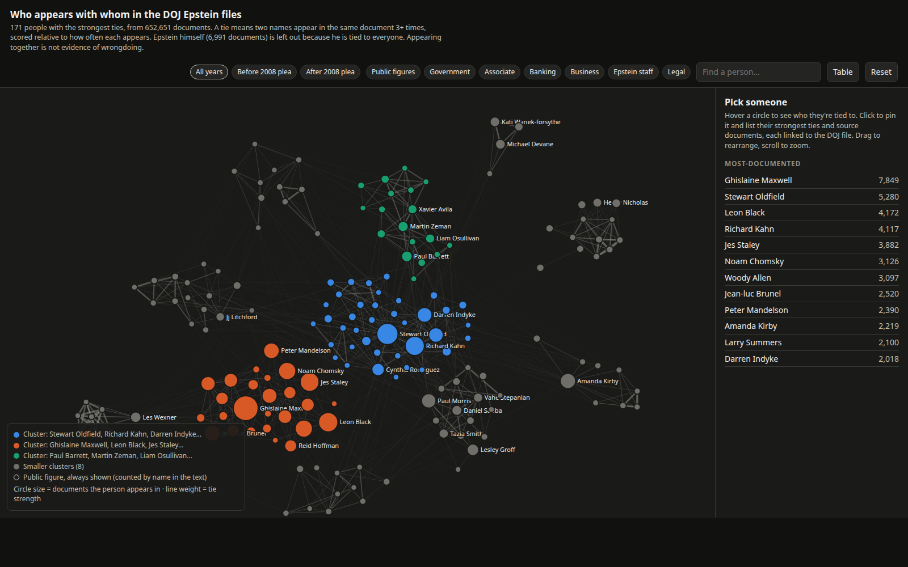

# Epstein Files DB

Text and metadata from the DOJ's Epstein files release (Epstein Files Transparency Act) in one SQLite database, plus a relationship map of who appears with whom. This dataset is incomplete, but gross as is. Would love help filling it out.



## Quick start

```bash
git clone https://github.com/LMSBAND/epstein-files-db.git
cd epstein-files-db
pip install -r requirements.txt
```

Download `epstein.db.gz` and `SHA256SUMS` from the [latest release](https://github.com/LMSBAND/epstein-files-db/releases/latest), then:

```bash
sha256sum -c SHA256SUMS
gunzip epstein.db.gz
mkdir -p epstein_files && mv epstein.db epstein_files/
```

Build and open the map:

```bash
python build_map.py
xdg-open epstein_files/output/map.html     # or open it in any browser
```

## The map

- People ranked by how many documents they appear in. Ties are scored by association (shared documents relative to how often each person appears), so prolific names don't tie to everything.
- Epstein is left out of the drawing because he co-occurs with everyone.
- Clusters come from community detection. Click anyone to see their strongest ties and source documents, each linked to the DOJ file.
- **All years / Before 2008 plea / After 2008 plea**: documents split at Epstein's June 30, 2008 guilty plea. Dates are pulled from the text (email headers first, then dates in the body); undated documents appear only under All years. A dashed gold ring marks people who also appear in the other era.
- Appearing in the same document as someone is not evidence of wrongdoing.

## Scripts

| Script | What it does |
|---|---|
| `ingest.py` | Streams DOJ data sets into the DB: download a PDF, extract text (pdftotext, tesseract OCR for scans), store it, delete the PDF |
| `ner_extract.py` | spaCy named-entity extraction over the stored text |
| `build_map.py` | Builds the standalone map HTML from the DB |
| `doc_dates.py` | Best-guess document date from its text |
| `ocr_backlog.py` | OCRs long documents that ingest skipped |
| `person_snippets.py` | Text snippets around a name, with document IDs |
| `viral_terms.py` | Counts of the viral "code word" claims, with sample contexts |

## Database schema

| Table | Description |
|---|---|
| `files` | One row per document: filename, data set, size, sha256 |
| `text_cache` | Extracted text for each document |
| `entities` | NER entities (PERSON, ORG, etc.) per document |
| `entity_cooccurrence` | Pairs of people who appear in the same documents |
| `ingest_hits`, `ingest_chunks` | Ingest bookkeeping: page counts and progress through the EFTA number range |

## License

Public domain data. Code is provided as-is for transparency and independent verification.
